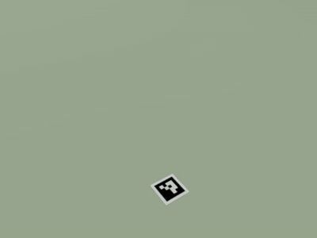
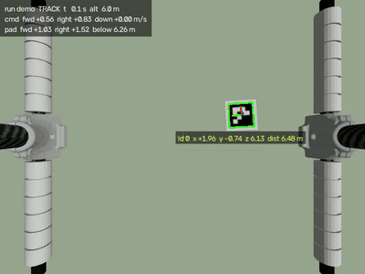
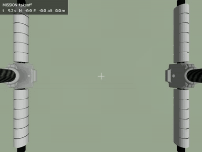
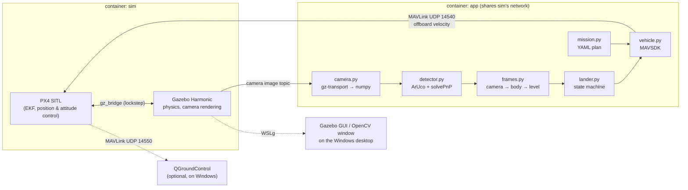
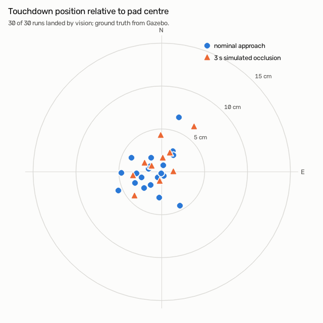
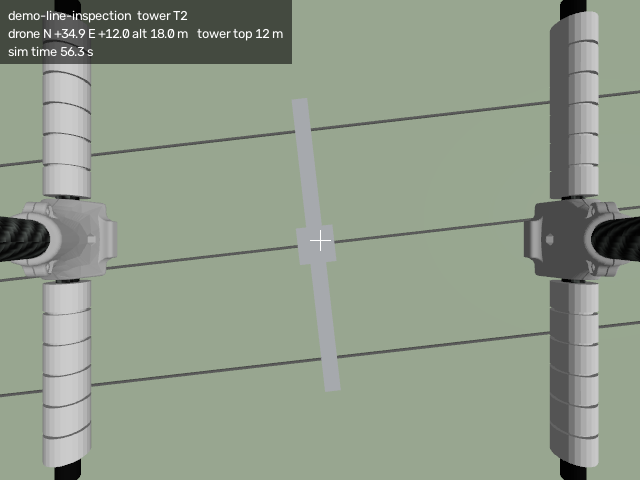

# px4-vision-landing

Vision-based precision landing and a simple power-line inspection mission
for a PX4 quadrotor, in simulation (PX4 SITL + Gazebo Harmonic).

A downward camera finds an ArUco marker on the landing pad. OpenCV
estimates the marker's pose, and a small Python state machine steers the
drone over the pad with MAVSDK offboard velocity commands. PX4's land mode
then takes over for touchdown. The mission flies a line of simplified
transmission towers from a YAML plan, photographs each tower, returns and
lands on the pad by vision.

| Precision landing, external view (2× speed) | Same flight, onboard camera (1.5× speed) |
|---|---|
|  |  |

In this flight the marker is hidden from the controller for 3 s
(simulated occlusion): the drone holds, climbs to widen its view,
re-acquires the marker and finishes the landing, 3.2 cm from the pad
centre. The external view comes from a static camera spawned into the
simulation ([`tools/record_observer.py`](tools/record_observer.py)).



**Result:** 30 of 30 logged landings touched down by vision, each after a
deliberately wrong approach of 0.65–1.97 m. Mean error **2.8 cm**, worst
**6.7 cm**, measured against Gazebo ground truth. See [Results](#results),
including a PX4 simulator crash that was found, traced and worked around
along the way.

## Architecture



| Module | Job |
|---|---|
| [`vland/camera.py`](vland/camera.py) | Subscribes to Gazebo's camera topic and turns each frame into a BGR numpy array with its simulation timestamp |
| [`vland/detector.py`](vland/detector.py) | Detects the ArUco marker, estimates its pose with `solvePnP`, draws the overlay |
| [`vland/frames.py`](vland/frames.py) | Camera optical → body FRD → level/NED conversions, including tilt compensation |
| [`vland/lander.py`](vland/lander.py) | The precision-landing state machine. Pure logic, unit-tested |
| [`vland/landing.py`](vland/landing.py) | Runs the state machine on the vehicle and hands over to PX4 LAND |
| [`vland/vehicle.py`](vland/vehicle.py) | MAVSDK wrapper: telemetry, takeoff/land, offboard velocity, fly-to |
| [`vland/mission.py`](vland/mission.py) | Parses and validates the mission YAML |
| [`vland/groundtruth.py`](vland/groundtruth.py) | Gazebo's true poses. Used only to *measure*, never to control |

The reasoning behind each choice (stack, frames, controller, the
rendering-speed work, and what doesn't transfer to a real line) is in
**[DESIGN.md](DESIGN.md)**.

## Setup (Windows + WSL2 + Docker Desktop)

Everything runs in Docker; the only host requirements are:

1. **WSL2** with an Ubuntu distro (`wsl --install -d Ubuntu`), and **WSLg**,
   which ships with current WSL (`wsl --version` shows a WSLg version).
2. **Docker Desktop** using the WSL2 backend, with *Settings → Resources →
   WSL integration* enabled for your distro. Check from inside WSL:
   `docker version` should show both client and server.
3. Work inside the WSL filesystem (`~/...`), not under `/mnt/c`.

```bash
git clone https://github.com/<you>/px4-vision-landing.git ~/px4-vision-landing
cd ~/px4-vision-landing
docker compose up -d --build        # builds the image, starts PX4 + Gazebo
```

The Gazebo window appears on the Windows desktop once PX4 has spawned the
drone (~30–60 s), with its camera following the drone. The first build
downloads PX4's prebuilt simulation image (~0.7 GB).

On a laptop the Gazebo window is a coarse live view. It updates in bursts
and doesn't respond well to the mouse, because WSLg draws it through the
GPU bridge while the CPU renders the drone's camera. For a smooth view use
`--show` (the onboard camera window) or the videos the scripts save to
`output/`.

On a native Linux host without WSLg, remove `compose.wslg.yaml` from
`COMPOSE_FILE` in [`.env`](.env) and run headless with `GUI=0`.

## Running

```bash
# Milestone 1: scripted take-off and landing
docker compose exec app python scripts/takeoff_land.py

# Milestone 2: detect the marker in flight and compare with ground truth
docker compose exec app python scripts/detect_marker.py --show

# Milestone 3: precision landing (approach error 1.5 m N, 1 m W of the pad)
docker compose exec app python scripts/precision_land.py --show
docker compose exec app python scripts/precision_land.py --occlusion 5,3   # hide marker 3 s

# Milestone 4: the inspection mission (restart the sim in the powerline world)
docker compose down && WORLD=powerline docker compose up -d
docker compose exec app python scripts/run_mission.py missions/powerline.yaml

# Unit tests
docker compose exec app python -m pytest -q
```

Each flight script expects a freshly started simulator (drone on the
ground at home): `docker compose down && docker compose up -d`. Videos and
images go to `output/` (git-ignored), and each landing appends a row to
`output/landing_runs.csv`. The published results in `results/` come only
from `tools/batch_landings.sh`.

| Variable | Default | Effect |
|---|---|---|
| `WORLD` | `landing_pad` | Gazebo world: `landing_pad` or `powerline` |
| `GUI` | `1` | `0` runs Gazebo without a window (about twice as fast) |
| `SENSOR_RENDER_DRIVER` | `llvmpipe` | Mesa driver for the camera rendering (see DESIGN.md §3.1) |
| `GUI_RENDER_DRIVER` | `d3d12` | Mesa driver for the Gazebo window |
| `ULOG` | `0` | `1` re-enables PX4's onboard ULog logger (off because of a SITL crash, see DESIGN.md §9) |

Set them when starting the simulator, e.g. `GUI=0 WORLD=powerline docker compose up -d`.

**QGroundControl** (optional): PX4 sends its ground-station link to the
Windows host on UDP 14550, where QGroundControl listens by default. The
MAVLink stream arriving on Windows has been verified with a UDP listener;
QGroundControl itself wasn't part of the tested setup.

## Results

All numbers below come from logged runs in [`results/`](results/),
produced by [`tools/batch_landings.sh`](tools/batch_landings.sh). Each run
restarts the simulator, takes off, and flies to the pad's *nominal*
position plus a random approach error (uniform over a 2 m radius disc,
seeded), as GNSS and map error would. Vision then takes over at 6 m.
**Landing error** is the horizontal distance between PX4's body origin and
the pad centre after disarm, taken from Gazebo's ground-truth poses. The
controller never sees ground truth.



| Condition | Runs | Precision landings | Mean error | Median | Std dev | Max |
|---|---|---|---|---|---|---|
| Nominal (no occlusion) | 20 | 20/20 | 2.7 cm | 2.6 cm | 1.7 cm | 6.7 cm |
| With 3 s simulated occlusion | 10 | 10/10 | 2.8 cm | 2.3 cm | 1.7 cm | 6.4 cm |

- Vision-controlled phase: 11.0 s of simulated time on average (15.6 s
  with an occlusion, which adds the hold, climb and re-acquire). Every
  occlusion run recorded exactly one marker loss and recovered from it;
  no nominal run lost the marker.
- Over all 30 landings the mean offset is under 1 cm (N +0.3, E −0.9 cm),
  so the errors are scatter, not a systematic bias.
- The handover rule requires the *vision-estimated* offset to be under
  10 cm. The last ~0.8 m is flown by PX4's LAND mode on its own position
  estimate; how much of the residual each phase contributes hasn't been
  measured separately.

Per-run data: [`results/summary.md`](results/summary.md) and
[`results/landing_runs.csv`](results/landing_runs.csv).

**A simulator crash, found and traced.** PX4 SITL occasionally died
mid-flight (segfault, about 1 run in 20, no log message). Running PX4 under
gdb caught it in PX4's own onboard **logger** thread
([backtrace](docs/px4_logger_crash.txt)), so the logger is now disabled in
SITL. The same 30 seeds were flown with the logger still on, and one run
was lost to the crash: 29/30 landings, mean 3.3 cm. That batch is kept in
[`results/logger_on/`](results/logger_on/summary.md) for comparison. Full
write-up in [DESIGN.md §9](DESIGN.md#9-investigation-intermittent-px4-sitl-crash).

**Mission.** Three consecutive runs of `missions/powerline.yaml` (3
towers, about 110 s of simulated flight each) captured all three towers and
landed by vision with errors of **1.4, 2.4 and 1.4 cm**. Each run's
`summary.json` (capture positions and times, landing error) is in
[`results/missions/`](results/missions/).



## Tests

`python -m pytest -q` runs without the simulator:

- `tests/test_frames.py`: frame conventions, quaternion → rotation, tilt
  compensation, heading-independence of the level frame.
- `tests/test_detector.py`: renders the marker at known poses with the
  same pinhole model and checks detection and `solvePnP` recover them.
- `tests/test_lander.py`: every state-machine transition (search,
  track, cone-gated descent, final handover, hold → climb → re-acquire,
  timeouts).
- `tests/test_mission.py`: mission parsing and validation, including
  the repo's own mission file.
- `tests/test_world_gen.py`: the committed `worlds/powerline.sdf` matches
  what the mission file generates, and towers and pad sit where the plan
  says.

## Limitations & next steps

This demonstrates the *pattern* (perception → relative pose → closed-loop
guidance → autopilot handover) in a clean simulation. Docking on a live
transmission line is much harder; DESIGN.md §8 goes into detail.

- **Wind and a moving target.** No wind here. On a line, gusts and conductor
  sway mean the target moves; the next step is a target-state estimator
  (Kalman filter over position and velocity, fused with IMU, as PX4's
  `vision_target_estimator` does) instead of a P-controller on raw
  measurements.
- **GPS-denied relative navigation.** Near conductors what matters is
  centimetre-level position *relative to the line*, not GNSS. Relative
  sensing (vision, lidar, the line's magnetic field) has to be the primary
  source in the final approach.
- **EMI near conductors.** Strong, varying magnetic fields corrupt the
  magnetometer and so the heading. Even without EMI the sim showed a 6°
  heading-estimate error, which is why the controller was made independent
  of heading. Near a line you'd drop magnetometer fusion close in.
- **Detecting the line itself.** A fiducial on a pad is the easy case; a
  real system must detect a thin conductor against sky and terrain.
- **Edge compute.** Perception here runs on a desktop CPU at 15 Hz; on the
  aircraft it must fit a companion computer's power budget with bounded
  latency, and camera frames should be time-matched to attitude rather than
  paired by "latest".
- **Sim fidelity.** Ideal pinhole camera, no distortion, motion blur or
  glare; simplified towers; straight conductors without sag.

## Acknowledgements

Built on [PX4](https://px4.io) (BSD-3), [Gazebo](https://gazebosim.org),
[MAVSDK](https://mavsdk.mavlink.io) and [OpenCV](https://opencv.org). The
worlds start from PX4's `default.sdf`; the drone model includes PX4's x500.
